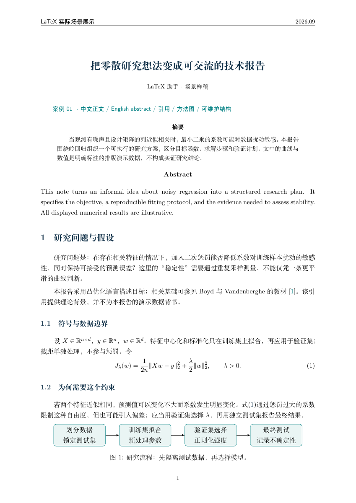
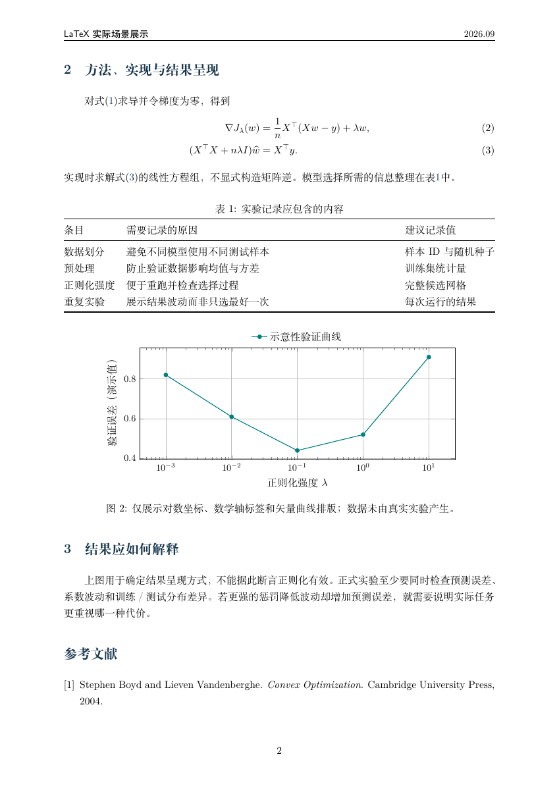

# LaTeX Writer

用自然语言写 LaTeX：从中文论文、数学公式和复杂表格，到 TikZ 绘图、图片转写与已有工程的报错修复。

[English](README_EN.md) · [效果展示](#效果展示) · [给-agent-的安装说明](#给-agent-的安装说明) · [MIT License](LICENSE)

## 一句话安装

把下面这句话发给你的 Agent：

```text
帮我安装这个 LaTeX Writer skill：https://github.com/zxw1992/latex-writer
```

适用于能访问 GitHub、写入本地文件并加载 skills 的 Agent，例如 Codex 和 Claude Code。Agent 按本文后面的安装说明操作即可。

## 安装后怎么用

直接描述需求，或在支持显式调用的客户端选择 `latex-writer`：

```text
帮我创建一份中文研究报告，包含摘要、公式、三线表、方法流程图和参考文献。
```

```text
把这张手写笔记转成可编辑的 LaTeX，保留高亮和图形，不确定的符号单独标出来。
```

```text
修复这个已有 LaTeX 工程的编译错误，保留文档类、编译引擎和参考文献配置。
```

| 任务 | 处理方式 |
| --- | --- |
| 中文、英文论文和报告 | 按正文语言与模板要求选择文档类、字体和编译方式 |
| 数学公式与表格 | 公式对齐、编号、三线表、跨页表格与交叉引用 |
| TikZ 与 Beamer | 可编辑的矢量示意图、流程图和学术幻灯片 |
| 图片转 LaTeX | 转写公式、表格和图形，保留内容，标注不确定处 |
| 已有项目修改 | 保留模板、宏定义、标签和文献数据，做必要修改 |
| 编译与版面检查 | 使用可用工具检查日志、引用和页面，报告实际验证范围 |

## 效果展示

下面是此前实际场景测试中完成的**同一份两页中文研究报告**，展示中英文摘要、公式推导、TikZ 流程图、三线表、PGFPlots 曲线和参考文献。两张图直接来自最终 PDF 页面渲染。

[查看完整 PDF](examples/research-report/main.pdf) · [查看 LaTeX 源码](examples/research-report/main.tex) · [原始需求](examples/research-report/PROMPT.md) · [案例说明](examples/research-report/README.md)

### 第 1 页：中英文内容、数学公式与方法流程



### 第 2 页：公式推导、三线表、曲线图与参考文献



这是经过编译、检查和修订的案例，不代表一次生成成功率，也不是模型对照评测。图表数值已明确标为演示数据，不构成研究结论。

## 给 Agent 的安装说明

用户要求安装本仓库时，按以下说明完成安装。安装目标是 skill 文件，不是 LaTeX 编译器。

### 1. 获取完整技能目录

- 仓库：`https://github.com/zxw1992/latex-writer`
- 默认分支：`main`；用户指定 tag 或 commit 时使用指定版本。
- 技能路径：`skills/latex-writer/`
- 技能名：`latex-writer`

将仓库克隆或下载到临时目录，读取此 README，复制 **`skills/latex-writer/` 的完整内容**，保留 `references/`、`evals/` 和 `LICENSE`。不要只下载 `SKILL.md`，也不要把仓库根目录当作技能目录。`docs/` 和 `examples/` 用于展示，不必安装。

Codex 有可用的 `$skill-installer` 时，优先使用它，传入仓库 `zxw1992/latex-writer` 和路径 `skills/latex-writer`，由它管理目标位置。不要同时向多个目录重复安装。

### 2. 选择当前客户端支持的位置

| 客户端 | 用户级安装位置 | 仅当前项目安装位置 |
| --- | --- | --- |
| Codex（手动安装） | `~/.agents/skills/latex-writer/` | `<项目根目录>/.agents/skills/latex-writer/` |
| Claude Code | `~/.claude/skills/latex-writer/` | `<项目根目录>/.claude/skills/latex-writer/` |
| 其他 Agent | 查询该客户端的 skills 文档后确定 | 查询该客户端的 skills 文档后确定 |

默认使用当前客户端的用户级位置；用户明确要求项目级时使用项目级位置。`~` 指当前用户主目录。遵守客户端的写入权限流程。上述位置来自 [Codex 文档](https://learn.chatgpt.com/docs/build-skills) 和 [Claude Code 文档](https://code.claude.com/docs/en/skills)，不代表所有客户端都经过端到端测试。

### 3. 处理已有安装

先检查目标是否存在及是否为符号链接。已有安装时比较内容；完全相同则跳过。有差异时先保留旧版本到技能扫描目录之外，再更新，避免丢失本地修改，也避免备份被识别成重复技能。不要跟随未知符号链接覆盖其他工程。

### 4. 验证并反馈

- 确认目标下有 `SKILL.md`，frontmatter 的 `name` 为 `latex-writer`，`description` 非空。
- 检查 `SKILL.md` 引用的 `references/*.md` 全部存在；将安装文件与下载源比较。
- 报告安装路径及所安装的 commit/tag。区分“文件已安装”和“客户端已识别”。
- 如果客户端有技能列表，检查 `latex-writer` 是否出现；未出现时重新加载或重启客户端后再检查。
- Codex CLI 可用 `$latex-writer`，Claude Code 可用 `/latex-writer`；支持选择器的客户端也可直接选择技能。

可用下面的需求做一次功能检查；只报告实际执行的验证：

```text
使用 latex-writer 创建一个包含中文、数学公式和三线表的最小文档，并报告编译与版面检查结果。
```

## 编译环境

安装 skill 本身不需要 TeX，也不需要 API Key。Agent 的运行和模型使用由所在客户端负责。

生成或修改源码可以直接开始；本地编译通常需要 TeX Live / MacTeX 等提供的引擎和宏包，参考文献按工程需要使用 BibTeX 或 Biber。页面渲染可使用 `pdftoppm`。若客户端提供内置编译器，优先使用适用的内置能力；已有模板则遵循工程配置。

缺少工具时应说明未验证项，不能把生成源码等同于编译成功。**不要因为用户只要求安装 skill，就自动安装整套 TeX 发行版。** 用户也可以把源码放到自己的 LaTeX 环境中编译。

## 开发与验证

```bash
python3 skills/latex-writer/evals/run_regressions.py
```

此命令检查技能元数据、引用路径、评测输入、参考示例编译及预期报错。需要 Python 3、PyYAML 或 Ruby/Psych，以及相应 TeX 工具；缺失工具记为跳过。结果写到临时目录，也可用 `--output <新的目录>` 指定位置。

本次发布检查：[验证记录](docs/verification.md)（18 项通过，1 项因本机 Biber 启动错误失败）。

公开版保留 8 个行为评测用例。历史手写图像用例因原图再分发授权未确认而未纳入；图片转写能力仍在技能中，但这里不声称已完成公开版多模态评测。回归脚本不运行模型对照实验，生成的页面还需要视觉检查。

提交问题时请附最小复现、客户端和编译引擎、相关日志，并移除个人信息。改动参考示例或验证脚本后，请运行回归检查。

## 许可证

[MIT](LICENSE) · Copyright © 2026 zxw1992
