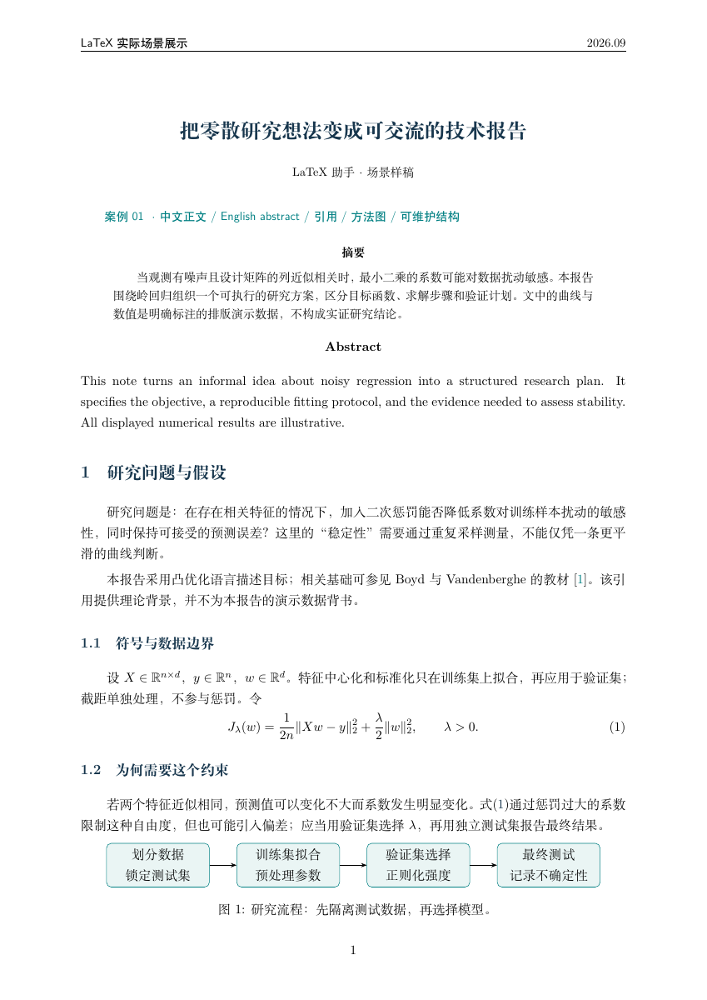
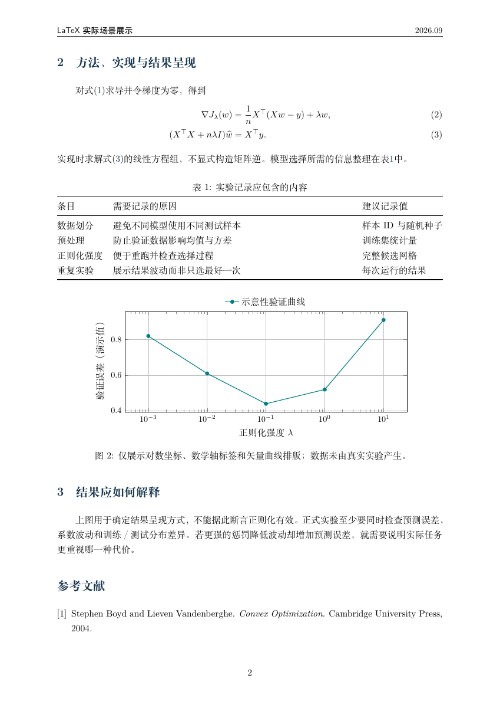

# LaTeX Writer

An Agent Skill for Chinese and English LaTeX documents, mathematics, tables, TikZ diagrams, image transcription, and repairs to existing projects.

[中文](README.md) · [MIT License](LICENSE)

## Install with one prompt

```text
Install this LaTeX Writer skill for me: https://github.com/zxw1992/latex-writer
```

Use an agent that can access GitHub, write local files, and load skills, such as Codex or Claude Code.

## Try it

```text
Create a Chinese research report with an English abstract, equations, a booktabs table, a method flowchart, and references.
```

```text
Transcribe this handwritten page into editable LaTeX. Preserve highlights and diagrams, and flag uncertain symbols.
```

```text
Fix this project's compilation error while preserving its document class, engine, macros, labels, and bibliography setup.
```

## Actual output

Two pages from one research-report example demonstrate bilingual text, equations, a TikZ flowchart, a table, a PGFPlots chart, and references.

[PDF](examples/research-report/main.pdf) · [Source](examples/research-report/main.tex) · [Original prompt](examples/research-report/PROMPT.md)





These are direct renders of a previously compiled and revised example, not a one-shot success claim or a controlled model comparison. Numerical results are explicitly illustrative, not empirical findings.

## Installation instructions for agents

1. Fetch `https://github.com/zxw1992/latex-writer`, using `main` unless the user specifies a tag or commit. Install the complete **`skills/latex-writer/`** directory, including `references/`, `evals/`, and `LICENSE`. Do not install the repository root or only `SKILL.md`. Showcase files under `docs/` and `examples/` are not required.
2. In Codex, prefer the available `$skill-installer`, with repository `zxw1992/latex-writer` and path `skills/latex-writer`; let it manage the destination. For manual installation, use `~/.agents/skills/latex-writer/` for Codex or `~/.claude/skills/latex-writer/` for Claude Code. For a user-requested project installation, use the corresponding `.agents/skills/` or `.claude/skills/` directory in the project. For other hosts, check their documentation. Do not install duplicate copies across locations.
3. Inspect an existing target, including symlinks. Skip identical content. Before updating differing files, preserve the old copy outside skill-discovery directories so local edits are recoverable and backups do not appear as duplicate skills. Follow the host's permission flow.
4. Verify `SKILL.md`, its `name: latex-writer`, its nonempty description, and all referenced files. Compare installed files with the downloaded source. Report the path and installed commit/tag. Check the host's skill list when available; distinguish file installation from confirmed discovery. Reload or restart if necessary.
5. Invoke `$latex-writer` in Codex CLI or `/latex-writer` in Claude Code, or use the host's skill picker. A suitable smoke test is a short document with Chinese text, an equation and a table; report only checks actually performed.

Paths follow [Codex documentation](https://learn.chatgpt.com/docs/build-skills) and [Claude Code documentation](https://code.claude.com/docs/en/skills). This is not a claim of end-to-end testing on every host.

## Compilation tools

Installing the skill requires neither TeX nor an API key. Model access is managed by the agent host. Compiling locally requires the project's TeX engine, packages and bibliography backend. Use an appropriate built-in compiler when the host provides one; preserve an existing project's build configuration. Page rendering can use `pdftoppm`.

Do not install a full TeX distribution merely because the user requested this skill. Report unavailable tools and unverified output honestly.

## Development

```bash
python3 skills/latex-writer/evals/run_regressions.py
```

The script validates metadata, reference paths, evaluation inputs, example compilation and expected errors. It requires Python 3, PyYAML or Ruby/Psych, and the relevant TeX tools. Missing tools are recorded as skipped. Output goes to a temporary directory unless a new directory is supplied with `--output`.

[Release verification](docs/verification.md): 18 checks passed; one failed because the local Biber executable could not start.

The public suite contains eight behavioral cases. A historical handwritten-image case is excluded because redistribution permission for its source image has not been established. Image transcription remains part of the skill; no public multimodal evaluation result is claimed. This script does not run model comparisons, and rendered pages still require visual inspection.

When reporting issues, include a minimal reproduction, host, engine and relevant logs, with personal information removed. Run regressions after changing reference examples or verification code.

## License

[MIT](LICENSE) · Copyright © 2026 zxw1992
